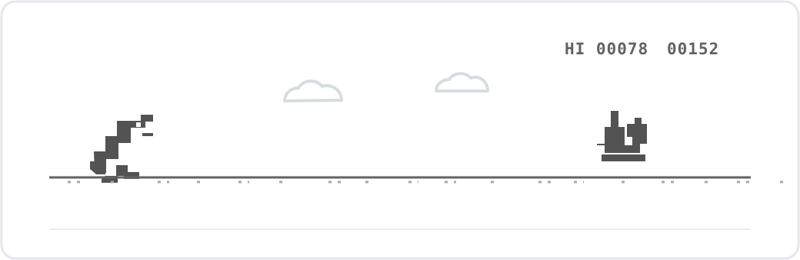

# ¡Hola! Soy Natalia Lizeth Huanca Quispe 👋

### Estudiante de Ingeniería en Informática y Sistemas · UNJBG

📍 Tacna, Perú &nbsp; · &nbsp; 💻 Explorando tecnología y creatividad

---

## Un poco sobre mí

Tengo 18 años y estudio **Ingeniería en Informática y Sistemas** en la Universidad Nacional Jorge Basadre Grohmann (UNJBG). Me gusta combinar el mundo digital con el diseño: disfruto aprendiendo, creando y dando forma visual a nuevas ideas.

## Diseño gráfico

| Herramienta | Experiencia |
|:--|:--|
| Adobe Photoshop | Edición y composición de imágenes |
| Adobe InDesign | Diseño y maquetación editorial |
| Adobe Animate | Animación y contenido multimedia |

## Idiomas

🇵🇪 **Español** · nativo &nbsp;&nbsp; 🇬🇧 **Inglés** · intermedio

## Música que me acompaña 🎧

Me apasiona la música electrónica y el pop rock. En mi playlist encontrarás a **Alan Walker** y canciones como *Faded*, *Wake Me Up* y *Adventure of a Lifetime*.

## Cuando se va el internet… 🦖

  

*La conexión volverá; mientras tanto, siempre hay algo nuevo que aprender.*

