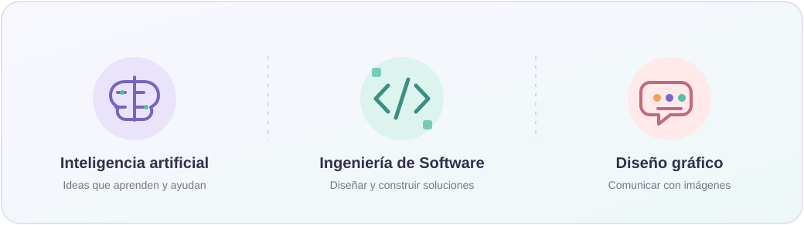

  

# ¡Hola! Soy Natalia Lizeth Huanca Quispe 👋

### Estudiante de Ingeniería en Informática y Sistemas · UNJBG

📍 Tacna, Perú · 🤖 Inteligencia artificial · 🧩 Ingeniería de Software · 🎨 Diseño gráfico

---

## Un poco sobre mí

Tengo 18 años y estudio **Ingeniería en Informática y Sistemas** en la Universidad Nacional Jorge Basadre Grohmann (UNJBG). Me interesan la **inteligencia artificial** y la **Ingeniería de Software**, además de explorar cómo estas áreas pueden relacionarse con el diseño para convertir ideas en propuestas útiles y visuales. Disfruto aprendiendo y experimentando con herramientas digitales.

## Lo que me interesa

  

## Diseño gráfico

Me gusta la **edición y composición visual**, la **maquetación editorial** y la **animación**.

## Idiomas

🇵🇪 **Español** · nativo · 🇬🇧 **Inglés** · intermedio

## Música que me acompaña 🎧

Me apasionan la música electrónica y el pop rock. Suelo escuchar a **Alan Walker** (*Faded*), **Avicii** (*Wake Me Up*) y **Coldplay** (*Adventure of a Lifetime*).

## Cuando se va el internet… 🦖

Una versión ilustrada de la clásica pantalla del juego del dinosaurio de Chrome:

  

*La conexión volverá; mientras tanto, siempre hay algo nuevo que aprender.*

